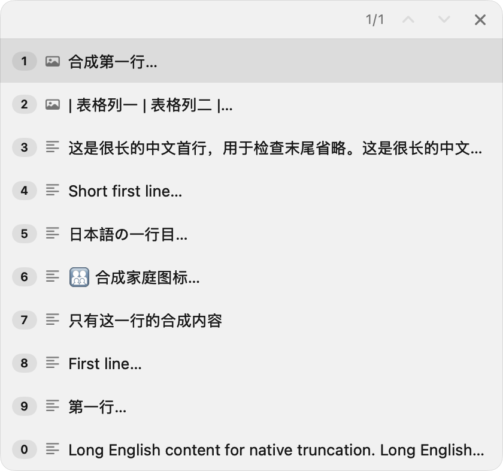
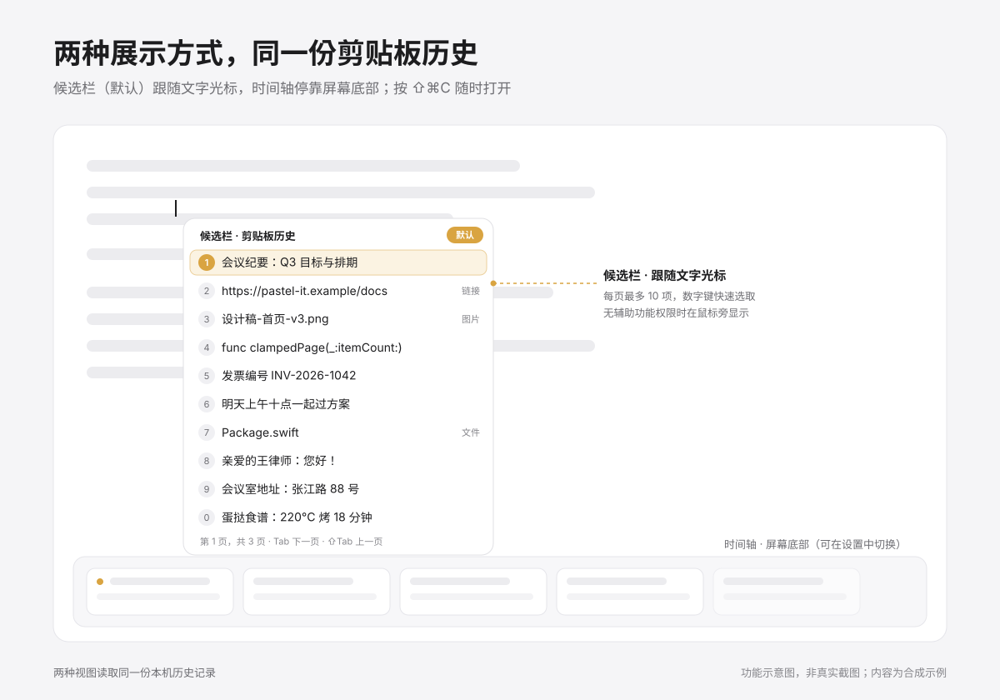
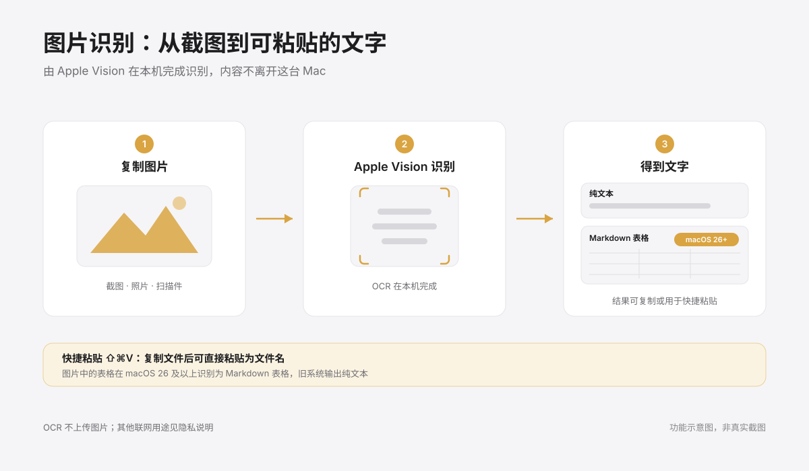

# Pastel it！


**A native macOS clipboard manager with on-device OCR, a copy-time timeline and a candidate list beside your typing caret.**

[中文](README.md) · [User guide](docs/getting-started.md) · [Documentation](docs/README.md) · [Development & AI workflow](docs/development.md) · [Attribution & dependencies](THIRD_PARTY_NOTICES.md)

> Derived from [Paste It](https://github.com/yipeng-git/paste-it), by Yipeng Zhang and contributors. **OpenAI Codex wrote and integrated the main additions and modifications in this derivative**, with the maintainer defining requirements and accepting behavior. **Kimi Code** contributed selected UI design and implementation. Upstream code and third-party components retain their own attribution and licenses.

## Features at a glance

| Feature | Behavior |
| --- | --- |
| Clipboard history | Text, rich text, links, images and file references; search, filtering, pins, folders and previews |
| Candidate list | Up to ten vertical rows beside the caret; number selection, Tab paging and single-line summaries |
| Timeline | Horizontal cards at the bottom of the screen, wheel navigation and copy-time selection |
| Text OCR | Apple Vision recognition with automatic or selected supported languages, including Chinese, English and Japanese |
| Table OCR | Markdown tables with surrounding text on macOS 26+ |
| Quick Paste | Converts the **current system clipboard** to plain text; selectable text, image OCR and file-name scopes; off by default |
| Privacy & recovery | No usage analytics; separately clearable local logs; English fallback and verified language-pack repair |

Timeline and Candidate List use the same history. Timeline is suited to browsing and organization; Candidate List is suited to inserting recent items while typing. Caret positioning requires Accessibility and support from the target app. Otherwise the list opens beside the pointer.

<details>
<summary>Candidate list example — synthetic records</summary>



This screenshot contains synthetic data from an isolated review, not a user’s clipboard.

</details>

## Everyday controls

- Open history: **⇧⌘C**.
- Quick Paste: **⇧⌘V**, after enabling it in Settings.
- Candidate selection: **1–9 and 0** for the current page.
- Paging: **Tab / Shift-Tab**; paging stops at either end.

Choose Timeline or Candidate Bar under Settings → Clipboard → Display Style. Candidate selection retains the original item type and follows Copy/Direct Paste settings. Image-to-text conversion belongs to Quick Paste. Global shortcuts can be changed or cleared independently, with conflict checks.

## Added in this derivative

- Default caret-side vertical candidates: ten items, number selection, Tab paging, single-line summaries and image/file hover previews.
- Copy-time navigation and wheel browsing in the alternative timeline.
- Local Vision table OCR to Markdown (macOS 26+), OCR settings, and Quick Paste for current clipboard text, images or file names.
- Missing-language recovery without launch crashes; no usage analytics; separately clearable local diagnostic logs.
- Simplified native settings and permissions. Paste Stack, MCP and automatic updating remain disabled.




The illustrations use synthetic examples, not real clipboard contents.

## Download and install

Get the **v0.3.0 Apple Silicon (arm64) DMG** from [Releases](https://github.com/Haookun/pastel-it/releases/latest). Drag the app into Applications. There is no Intel binary or automatic updater in this release.

The app is ad-hoc signed and **not Apple notarized**. For a trusted download blocked by Gatekeeper, follow macOS’s per-app **Open Anyway** flow in System Settings → Privacy & Security. Do not disable system protection. [Distribution guide](docs/distribution.md).

Version 0.3.0 has an independent identity, `io.github.haookun.pastel-it`, and new data in `~/Library/Application Support/PastelIt/`. It does not read, migrate or remove the upstream/old private build’s history or preferences. Grant Accessibility separately for the new app.

## Build from source

Deployment target: macOS 14. Modern text OCR requires macOS 15+, tables macOS 26+. Swift 6.4+, matching Xcode/Command Line Tools and Python 3 are required. Apple Silicon is the first supported binary target; older systems and Intel have not had full manual acceptance.

```sh
git clone https://github.com/Haookun/pastel-it.git
cd pastel-it
swift test --scratch-path /private/tmp/pastel-it-build
PASTEIT_BUILD_PATH=/private/tmp/pastel-it-build \
  ./scripts/package-release.sh --variant arm64 --local-test
# Ad-hoc signed DMG, without automatic upload
PASTEIT_BUILD_PATH=/private/tmp/pastel-it-build \
  ./scripts/package-release.sh --variant arm64 --adhoc-release
```

See [development](docs/development.md) and [release validation](docs/release-0.3.0.md) for evidence and limitations.

## Privacy and networking

History and attachments stay in `~/Library/Application Support/PastelIt/`. OCR runs through Apple Vision. There is no usage analytics SDK, and runtime OCR does not call OpenAI or Kimi.

Link previews may contact the destination website or fetch its icon. Language repair contacts GitHub only after an explicit request. Private repositories require browser sign-in and file import; public repositories support direct download. On-device OCR does not mean every feature is network-free. [Privacy details](docs/analytics.md).

## Credits and limits

The original [MIT copyright and license](LICENSE) are retained. Direct dependencies are **Sparkle 2.9.4** and **MCP Swift SDK 0.12.1**; their update/server startup is disabled, but retained code still compiles against them. The locally verified graph also includes Swift System, SwiftLog and EventSource. See [full notices and license texts](THIRD_PARTY_NOTICES.md).

SwiftUI, AppKit, Vision and SwiftData provide the core UI, OCR and storage capabilities. Paste Stack is archived and disabled. The standalone legacy plain-paste command is removed; Quick Paste is the current conversion entry.

OCR quality depends on the system model and image. Sparse mixed-language text and complex tables may need correction. The verification record retains one known Vision limitation; real permissions and cross-app pasting still need user acceptance. [Validation](docs/validation.md).

The tart artwork uses maintainer-supplied references. See [design and asset provenance](docs/design.md), [project origin](docs/origin.md) and [contribution guidelines](CONTRIBUTING.md). Detailed user and engineering documents are primarily in Chinese.
