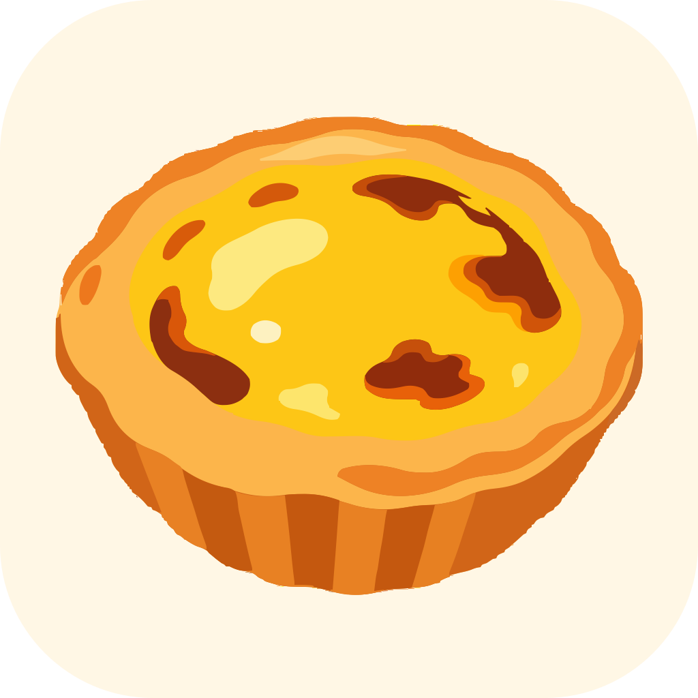
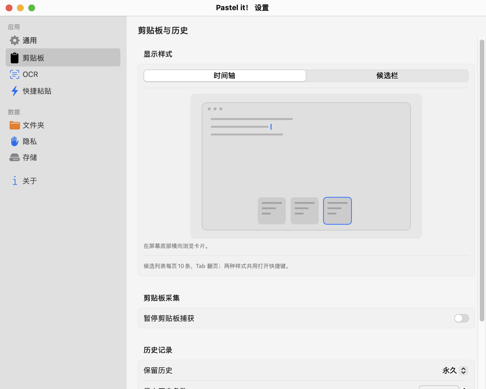

# Pastel it！设计说明

[项目首页](../README.md) · [AI开发分工及依赖](../THIRD_PARTY_NOTICES.md)

## 品牌

显示名为 **Pastel it！**，仓库名为 `pastel-it`。视觉以奶油蛋挞为主题：奶油底、金黄色馅心、橙色酥皮与深褐焦斑。名称与图形用于区分原 Paste It 项目；原项目署名与许可证继续保留。

| 用途 | 源稿 | 生成输出 |
| --- | --- | --- |
| 彩色应用图标 | `design/pastel-tart.svg`、`design/pastel-app-icon.svg` | `design/AppIcon.icon`、`Resources/AppIcon.icns`、`Resources/Assets.car`、`Resources/AppIcon.png` |
| 菜单栏图标 | `design/pastel-menubar.svg` | `Sources/PasteIt/UI/MenuBar/MenuBarTartArtwork.swift` |
| 图片参考 | `design/reference/cream-tart.png`、`design/reference/gold-tart.png` | 用户提供参考的去元数据副本 |

## 合作与素材来源

维护者提出品牌和交互需求并提供蛋挞参考图；Codex完成本派生版的主要新增代码、整合、矢量化与资源导出；Kimi Code参与部分UI设计、系统控件替换和布局实现。原始Paste It及第三方代码的署名不因此改变。参考图由维护者提供，本文记录来源，不据此补写未知的第三方授权。

界面优先采用SwiftUI／AppKit原生控件；卡片品牌标题、时间刻度、显示样式示意和菜单栏蛋挞等必要自绘保留。没有做统一性能基准，不把原生样式写成已证明的内存或耗电收益。

## 应用图标



奶油色参考图先去掉黑色外背景与圆角边缘残留，再保留酥皮、焦斑和高光进行路径追踪。色彩层次简化为平面色块，避免缩小时保留过多纹理噪声。矢量前景放入原生 Icon Composer 源包，关闭额外玻璃、镜面与阴影叠加，保留扁平插画特征。

默认背景为 `#FFF7E5`；深色外观采用温暖的深褐底。系统图标蒙版负责正式图标圆角，Markdown 预览使用带圆角的 PNG/SVG。正式资源由 Xcode actool 编译，同时提供旧系统使用的 ICNS 和资产目录。

SVG 是真正的路径文件，没有内嵌原 PNG。生成的 PNG 是矢量源的渲染结果，用于平台图标资源与文档预览。

## 菜单栏


极简金色参考图转换为单色模板：保留蛋挞外沿、奶馅留白、焦斑和酥皮竖向分片，清理透明边缘噪点。图案以方形坐标居中，状态图像尺寸为 24×22 pt。

菜单栏不使用固定金色，`isTemplate` 让系统按菜单栏明暗着色。按住 ⌘C 或 ⌘V 时轮廓略加粗，松开恢复；同时按住时加粗更明显。此处不再显示 C/V 字母，避免小尺寸文字拥挤。矢量路径编入应用，启动时不读取外部 SVG。

## 时间轴与设置

沿用原有系统玻璃面板和卡片，不另外叠加装饰性背景。底部增加时间刻度，悬停放大附近刻度、浮现完整时间，点击或拖动定位记录。面板高度增加到 380 pt，为固定高度卡片与时间轴留出空间；预览仍显示在面板上方。

OCR参数与快捷粘贴分为独立设置页：先在OCR页决定识别行为，再到快捷粘贴页选择纯文本转换范围。转换范围用复选框；启用功能、语言纠错与表格识别用开关。打开剪贴板默认 ⇧⌘C，快捷粘贴默认 ⇧⌘V；分别设置并检查冲突。

## 重新生成

已经提交生成文件，普通 Swift 构建不需要安装追踪工具。修改参考图并重新矢量化时：

```sh
python3 -m venv .venv-artwork
.venv-artwork/bin/pip install -r scripts/artwork-requirements.txt
.venv-artwork/bin/python scripts/vectorize-pastel-artwork.py
python3 scripts/generate-menubar-icon.py
swift scripts/generate-app-icon.swift
```

最后一条需要已安装 Xcode，只编译资源，不签名、不安装、不发布。菜单栏生成脚本只接受当前矢量源使用的绝对路径命令和 translate 变换；不支持的 SVG 特性会明确报错，避免悄悄生成错误图案。

## 本轮原生控件整理

设置保持 NavigationSplitView、List 与分组 Form，侧栏用 SF Symbols 原生标签，去掉自绘渐变徽章和设置表单内强加的玻璃按钮样式。OCR 按识别开关、语言、表格、参数和快捷粘贴分组；参数说明放 Section footer，高级参数用 DisclosureGroup。

时间线分类改为系统 segmented Picker，类型筛选改为系统 Menu 内的 Picker，由系统绘制选中标记和处理键盘菜单导航。卡片和文字预览使用普通系统内容背景，保留浮动面板的单层系统材质。时间轴因没有对应现成系统控件继续使用 SwiftUI 自定义绘制。

这主要减少自定义界面代码和维护工作；不承诺 OCR 速度或内存因此显著改善。视觉和真实交互等待用户确认。

## 第二轮：预览气泡与弹层补齐原生控件

图片预览的 Image / Text 页签从自绘玻璃胶囊改为系统分段 Picker（小尺寸），OCR 面板的 Copy / Edit / Re-run / Cancel / Save 从自绘文字按钮改为系统 `.accessoryBar` 按钮，由系统负责凹陷底板、按下反馈和禁用态。新建文件夹弹层的名称输入改用系统圆角边框文本框，与设置页表单的字段一致。同时移除不再使用的 FilterPill 和玻璃分段高亮等自绘辅助代码。卡片彩色标题栏、时间轴刻度、悬浮操作栏和菜单栏蛋挞图标属于品牌与无原生对应控件的绘制，维持自绘。

## 第三轮：对齐、对比与候选栏（10月20日设计，候选布局已由下一轮替代）

设置页将页标题移入内容列，与表单卡片的左边缘对齐。选中侧栏图标继承系统选中前景，未选中保留分类颜色；OCR 使用短侧栏名称，详情页保留完整标题。引导页取消固定标题高度与裁剪，按内容高度布局，增加上下留白与窗口高度，并本地化导航按钮。

候选栏借鉴输入法的数字候选：紧凑横条显示最近5项，强调当前候选；类型图标、短文本、额外文件数量与主操作分层展示，展开后保留顶部候选并用虚拟列表浏览更多。浮动预览按内容类型设置尺寸，图片使用已有异步缓存管线，文件显示完整路径。样式选择使用原生分段 Picker，沿用系统材质和颜色。

本轮 UI 初稿与实现由 Kimi Code CLI 承担；Codex 整合面板、偏好、按键、复制／粘贴保护并审查编译。Gemini 对授权的旧源码快照提供了文案核对候选；随后按更新分工测试会员入口时返回地区不可用，未切换API或修改网络，本轮新增候选栏翻译由 Codex 定稿与核对。

候选栏使用紧凑原生材质、细边框、系统窗口阴影和浅色／深色语义颜色。它在插入光标旁淡入；时间轴保留底部滑入动画。定位参考鼠须管的光标矩形、上下翻转与屏幕约束思路，由独立的 Accessibility 适配实现，不复制输入法源代码。

## 第四轮：原生列表与设置重整（2026-10-28）

候选窗保留 NSPanel 的光标定位与淡入，行列表使用 AppKit NSTableView／NSScrollView。每页10条，短尾页按实际行数缩短；Tab／Shift-Tab 与前后按钮使用同一分页逻辑，页首尾不循环。数字1–9／0针对当前页；控制器集中处理键盘，避免表格与外层同时响应。正常界面只有内容、页码、小图标；位置回退解释放入悬停帮助，操作失败才显示简短状态。

设置采用标准 AppKit 标题栏，下方是原生侧栏 List、单个分隔线与分组 Form。移除 fullSizeContentView、空 toolbar 与视图层次探测，分隔线仅存在于内容区。应用、数据、关于分组下保留原有全部设置，并将 OCR 与快捷粘贴拆为独立页。权限入口直接位于对应显示样式下，回到应用后更新状态。

样式选择下方通过 SwiftUI Canvas 绘制简化应用窗口：时间轴在底部横向排列，候选列表在正文光标旁纵向排列；轻微动画只演示位置与选择。减少动态效果时使用静态帧，无真实历史或额外图片资源依赖。SwiftUI.TimelineView 显式限定命名，避免与项目时间轴视图同名。

本轮 UI 实现优先交给 Kimi Code CLI；Codex 负责技术边界、分页与写入保护、集成、自动测试、原生窗口复验和本机编译。未接入 Spotlight 私有历史数据库。

### 动画比例修正（2026-10-28）

示意统一在480×300逻辑画布中绘制，仅用一次相同的横纵缩放变换。预览外框保持8:5、宽度最多410pt，居中而不铺满设置栏；圆点、线宽、圆角与位移同步缩放。候选弹窗为150×140逻辑尺寸，时间轴卡片为58×56，分别接近实际候选窗和卡片的比例。减少动态效果仍显示同一坐标系的静态帧。

## 面向读者的合成截图

以下PNG原样复制自隔离原生检查，不含真实用户剪贴板；只保留分辨率／尺寸等图像元数据。

| 图片 | 来源与用途 |
| --- | --- |
| [候选列表](images/candidate-list.png) | 2026-10-28单行摘要回归的合成记录，展示10项与尾部省略 |
| [样式设置](images/clipboard-style-settings.png) | 2026-10-28完整语言资源App的隔离设置检查，展示原生分组和时间轴示意 |



后者是设置内的矢量示意画面，不是实际历史卡片截图。旧工程记录中的截图不一定反映当前UI，以首页、功能说明和最近验证记录为准。

## v0.3.0 功能示意

`images/features-overview.svg` 与 `images/ocr-workflow.svg` 为 Kimi Code 制作、Codex 整合的静态矢量说明，使用合成内容、系统字体，无外部图片或脚本，不作为真实运行截图。维护者于2026-11-04确认蛋挞参考图可用于公开改编与分发。
